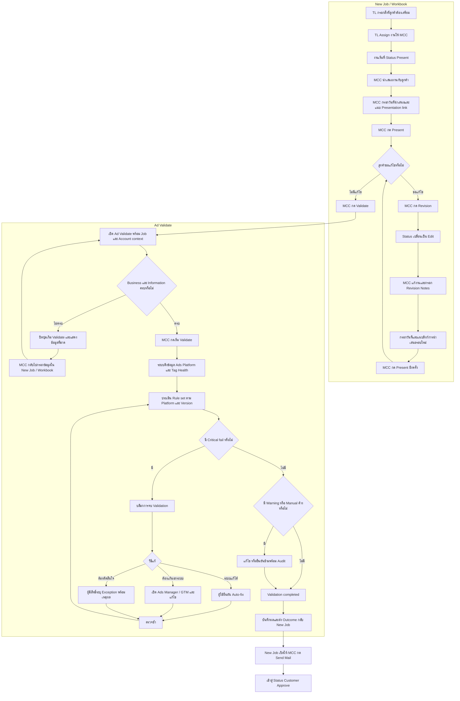
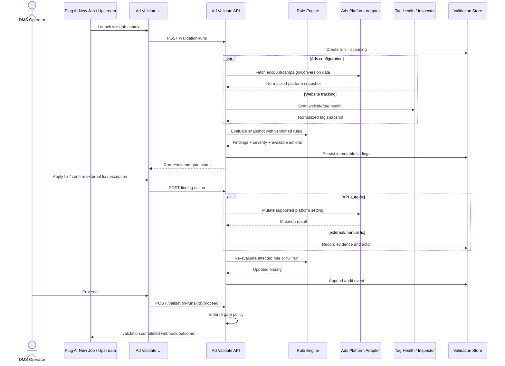

# Ad Validate — Product Requirements Document

Status: Draft for PO and Tech Lead review

Date: 2026-09-18

Product: Plus AdTech

Type: Feature / standalone module

## 1. Overview

Ad Validate เป็น pre-launch quality gate สำหรับแคมเปญโฆษณา ระบบรับข้อมูลงานและบัญชีโฆษณาจาก upstream system แล้วตรวจ rule ตามแพลตฟอร์ม สรุปความรุนแรง เสนอวิธีแก้ และส่งผลกลับเมื่อผู้ใช้ดำเนินการต่อ

การแยก repository ต้องทำให้ Ad Validate ไม่อ้างอิง DOM, state หรือ business logic ภายใน Plug AI New Job โดยตรง การเชื่อมกันต้องผ่าน input/output contract เท่านั้น

## 2. User flow

User flow นี้อ้างอิงขั้นตอนเปิดงานจาก DMS Workbook ชุด `[Update: 2026-06-12]` สไลด์ 9–26 โดยแบ่งขอบเขตเป็นสองส่วน:

- **New Job / Workbook:** ตั้งแต่ TL เตรียมข้อมูลจน MCC เลือกเข้าสู่ Validate
- **Ad Validate:** ตั้งแต่ตรวจ precondition, เริ่ม scan, แก้ไข และสรุป validation outcome



### Flow ก่อนเข้า Ad Validate

1. TL กรอกข้อมูลสิ่งที่ลูกค้าต้องเตรียม แล้ว Assign งานให้ MCC
2. งานของ MCC เริ่มต้นที่สถานะ `Present`
3. MCC นำเสนองานกับลูกค้า กรอกวันที่นำเสนอและแนบลิงก์ที่ใช้ในการนำเสนอ
4. MCC กด `Present` เพื่อบันทึกการนำเสนอ
5. หากลูกค้าขอแก้ MCC กด `Revision` และงานเข้าสถานะ `Edit`
6. MCC แก้งาน กรอก `Revision Notes` พร้อมวันที่และลิงก์การนำเสนอรอบใหม่ แล้วกด `Present` อีกครั้ง
7. ขั้นตอน Revision → Edit → Present สามารถวนซ้ำได้จนลูกค้าไม่มีรายการแก้ไข
8. เมื่อลูกค้าไม่มีรายการแก้ไข MCC กด `Validate` เพื่อเปิด Ad Validate

### Flow ภายใน Ad Validate

1. New Job ส่ง `job_id`, platform, website, ad account, Business information และ expected campaign configuration ให้ Ad Validate
2. ระบบตรวจ precondition ว่า Business และ Information ที่จำเป็นครบหรือไม่
3. หากข้อมูลไม่ครบ ปุ่ม `เริ่ม Validate` ต้องกดไม่ได้และต้องระบุข้อมูลที่ขาด พร้อมทางกลับไปแก้ใน New Job/Workbook
4. หากข้อมูลครบ MCC กด `เริ่ม Validate`
5. ระบบแสดง progress ของการเชื่อม API, ดึง campaign/conversion, ตรวจ tag health และประเมิน rules
6. ระบบจัดกลุ่มผลตาม Setup, Configuration และ Customization
7. MCC เลือก auto-fix, แก้นอกระบบแล้ว re-scan หรือบันทึก exception ตามสิทธิ์
8. Critical ทั้งหมดต้องผ่านก่อนจบ Validation
9. หากเหลือ Warning/Manual ผู้มีสิทธิ์ต้องยืนยันก่อนดำเนินการต่อ และระบบบันทึก audit
10. ระบบบันทึกผลและส่ง `Validation completed` กลับ New Job
11. New Job จึงเปิดให้ MCC กด `Send Mail` เพื่อเข้าสู่สถานะ `Customer Approve`; การส่งเมลและขั้นอนุมัติหลังจากนี้อยู่นอกขอบเขต Ad Validate

## 3. System flow



## 4. Integration boundary

### Launch input

```json
{
  "job_id": "35371801",
  "platform": "google",
  "website_url": "https://example.com",
  "ad_account_id": "452-118-3390",
  "expected_start_at": "2026-10-01T00:00:00+07:00",
  "expected_end_at": "2027-03-31T23:59:59+07:00",
  "expected_budget": { "amount": 35000, "currency": "THB", "mode": "lifetime" },
  "return_url": "https://upstream.example/jobs/35371801"
}
```

### Completion output

```json
{
  "job_id": "35371801",
  "validation_run_id": "avr_01K5...",
  "status": "passed_with_warnings",
  "platform": "google",
  "rule_set_version": "google-1.0.0",
  "summary": { "passed": 12, "critical": 0, "warning": 2, "manual": 0, "not_applicable": 1 },
  "completed_at": "2026-09-18T15:30:00+07:00",
  "completed_by": "user_123"
}
```

ค่าของ `status` ต้องเป็น `scanning`, `blocked`, `passed_with_warnings`, `passed`, `failed` หรือ `expired`

## 5. Functional requirements

### FR-01 Context validation

- ระบบต้องตรวจว่ามี `job_id`, platform, website URL และ ad account ID ก่อนเริ่ม scan
- Account ID ต้องตรงกับ platform
- หาก credential ไม่มีสิทธิ์อ่านบัญชี ต้องหยุด run และแสดงสาเหตุที่แก้ไขได้

### FR-02 Versioned rule sets

- ทุก rule ต้องมี ID, platform, category, severity, check type, evaluator version และ remediation type
- Rule set ต้อง version ได้ และ run เดิมต้องอ้างถึง version เดิมเสมอ
- Rule ที่มีเงื่อนไข เช่น Google P-028 ต้องทำงานเมื่อ dependency ผ่านและเลือก Plus AdTech เท่านั้น

### FR-03 Scan orchestration

- ระบบต้องแยก platform snapshot และ tag-health snapshot ออกจาก rule evaluation
- การ retry connector ต้องไม่สร้าง validation run ซ้ำ
- UI ต้องแสดงสถานะ scanning และป้องกันการกด scan ซ้ำ
- Google P-003 (Conversion activity) ต้องใช้ classifier เดียวกับ Ad Optimizer › Conversion Tag Health (`classifyConversionAction`, Jira MC-5705) ห้ามเขียนเกณฑ์ซ้ำใน Ad Validate และต้องเก็บทุกแถวเป็น snapshot ของ run — รายละเอียดใน `docs/superpowers/specs/2026-09-29-p003-conversion-tag-health-design.md`

### FR-04 Findings

- Finding ต้องแสดงเหตุผลที่ผ่าน/ไม่ผ่าน, impact, วิธีตรวจ, owner การแก้ และ timestamp
- หมวดขั้นต่ำ: Setup, Configuration, Customization
- Severity policy:
  - Critical: บล็อก proceed
  - Warning: proceed ได้เมื่อยืนยัน
  - Info: ไม่บล็อก
  - Manual: ต้องมีผู้ตรวจหรือหลักฐาน
  - Not applicable: ไม่นับเป็น fail

### FR-05 Remediation

- `auto_fix`: ระบบ preview การเปลี่ยนแปลงและเรียก platform mutation หลังผู้ใช้ยืนยัน
- `external_fix`: เปิด deep link ไปยัง platform/tool แล้วให้ผู้ใช้สั่ง re-scan
- `exception`: ต้องมี permission, เหตุผล และ evidence จากผลตรวจจริง ห้ามใช้เพื่อข้ามกรณีที่ไม่พบ conversion ใดทำงาน
- Bulk fix ทำได้เฉพาะรายการที่ไม่มี input เพิ่มและสามารถ rollback/ตรวจผลได้

### FR-06 Gate and proceed

- ก่อนมี scan ล่าสุด ปุ่ม proceed ต้องถูกปิด
- หากมี Critical fail ปุ่ม proceed ต้องถูกปิดจาก backend policy ไม่ใช่เฉพาะ UI
- Warning หรือ Manual ที่ยังค้างต้องมี confirmation และ audit event
- ผล scan ต้องมีอายุ; ค่าเริ่มต้นเสนอ 24 ชั่วโมง และต้องยืนยันกับ Tech Lead

### FR-07 Audit and history

- เก็บ actor, action, before/after, reason, connector response reference และ timestamp
- Finding history ต้อง append-only
- ผู้ใช้ต้องดู run ล่าสุดและ run ก่อนหน้าได้

### FR-08 Upstream notification

- เมื่อ proceed สำเร็จ ระบบต้องส่ง outcome กลับ upstream แบบ idempotent
- หาก callback ล้มเหลว ให้ retry และแสดงสถานะ sync โดยไม่ย้อนผล validation

## 6. Initial rule scope from prototype

### Google Ads

- Auto-apply recommendations
- Conversion method (P-027) และ conversion activity (P-003 — ใช้เกณฑ์ Conversion Tag Health ของ Ad Optimizer)
- Primary/secondary conversion
- Location, location option และ language
- Assets/ad strength
- Negative keywords และ network settings
- Mobile-app exclusions สำหรับ Display/YouTube
- Google Ads tag, GA4 tag และ Plus AdTech script health
- Plus AdTech/GTM duplicate-event conflict

### Meta Ads

- Pixel activity
- Custom/Lookalike audience readiness
- Naming convention
- Budget/end date และ daily/lifetime mode
- Advantage+ settings
- Website conversions
- CBO/ABO policy

### TikTok Ads

- Pixel activity
- Audience readiness
- Naming convention
- Objective และ budget type
- Configuration checks จาก prototype รวม CBO/ABO policy

Rule inventory ฉบับ production ต้องได้รับการ review แยกจาก UI เพราะข้อความใน prototype มีทั้ง mock data และ presentation scenarios

## 7. Permissions

- Operator: run, view, auto-fix ที่อนุญาต, re-scan
- Reviewer/Lead: สิทธิ์ Operator + approve warning/manual exception
- Admin: จัดการ credentials, rule activation และ rule-set rollout
- Service account: ส่ง context และรับ completion outcome เท่านั้น

## 8. Error and edge cases

- Token หมดอายุหรือ scope ไม่ครบ
- Account ถูกปิด, ไม่มี campaign หรือไม่มี conversion action
- Website เข้าถึงไม่ได้, redirect loop, consent banner ปิดกั้น scan
- Platform API rate limit หรือ partial response
- Mutation สำเร็จแต่ re-scan ยังไม่เห็นค่าใหม่เพราะ eventual consistency
- ผู้ใช้สองคนแก้ finding เดียวกันพร้อมกัน
- Rule set เปลี่ยนระหว่าง run
- Upstream job ถูกยกเลิกขณะกำลัง scan
- Callback ไป upstream ล้มเหลว
- Duplicate tracking: Plus AdTech, GTM และ legacy Autodigi ยิง event ซ้ำ

## 9. Data model — conceptual

- `validation_runs`: run identity, job/account context, platform, rule-set version, gate status, timestamps
- `validation_findings`: immutable evaluated result per rule and run
- `finding_actions`: fix, recheck, acknowledgement หรือ exception พร้อม actor/evidence
- `connector_snapshots`: normalized platform/tag data พร้อม expiry และ source reference
- `delivery_events`: outbound outcome, idempotency key, retry state

ชื่อ table/field จริงต้องอ้างอิง backend repository หลัง Tech Lead เลือก stack และ service boundary แล้ว

## 10. Acceptance criteria

- เปิด Ad Validate ได้โดยไม่โหลด Plug AI New Job UI หรือ state ภายใน
- ทั้งสาม platform เลือก rule set ของตนได้จาก launch context
- scan หนึ่งครั้งสร้าง run เดียวแม้ request ถูก retry
- Critical failure ทำให้ backend ปฏิเสธ proceed
- Warning ที่ข้ามได้ต้องมี actor, reason และ timestamp
- Auto-fix แสดง preview, บันทึก before/after และ re-evaluate ผล
- Google conversion method ไม่สามารถยืนยันผ่านได้เมื่อไม่พบ conversion ที่ firing
- Google P-003 ให้ป้าย Health ตรงกับการ์ด Conversion Tag Health ของ Ad Optimizer ทุกแถว · บล็อกเมื่อมี Primary เป็น Broken · Needs attention เป็น Warning · งานที่ทุก action เป็น Need more data ต้องไม่ถูกบล็อก
- Run เดิมแสดงผลด้วย rule-set version เดิมแม้มีการ publish rules ใหม่
- Completion callback ถูกส่งแบบ idempotent และ retry ได้
- ทุก action สำคัญค้นย้อนหลังจาก `job_id` และ `validation_run_id` ได้

## 11. Dependencies

- Ads Platform credentials และ API permissions
- Ad Optimizer/Inspector หรือบริการ tag-health ที่กำหนด contract ได้
- Conversion Tag Health classifier และ config เกณฑ์ของ Ad Optimizer (MC-5705) สำหรับ P-003
- Upstream launch/callback contract
- Identity/role service
- Web team สำหรับ remediation ที่อยู่นอกระบบ

## 12. Open decisions before build

1. Backend stack และ repository hosting organization
2. Ad Validate เป็น service ใหม่หรือ module ใน Plus AdTech backend แต่แยก repo
3. Credential ownership และ token refresh strategy
4. Source of truth ของ job/account mapping
5. Rule management จะเป็น code configuration หรือ admin UI
6. Scan expiry ที่เหมาะสมและ policy บังคับ re-scan ก่อนออนไลน์
7. ผู้มีสิทธิ์ approve Warning/Manual exception
8. Production rule inventory และ mapping API ที่ยืนยันแล้วของแต่ละ platform
